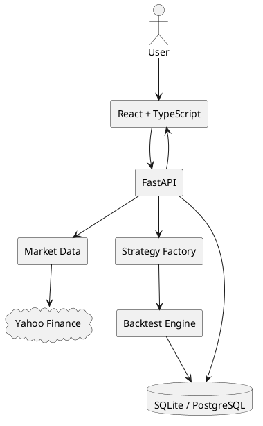

# AlgoTradeX Architecture

```text
React/Vite
   -> FastAPI REST
      -> MarketDataService -> yfinance / bundled demo data
      -> StrategyFactory -> SMA / RSI / Bollinger / MACD / Momentum
      -> BacktestEngine -> execution -> portfolio -> metrics
      -> SQLAlchemy -> SQLite (PostgreSQL-ready)
```

## Core execution algorithm
1. Load OHLCV data and sort chronologically.
2. Generate a signal using information available through the current completed bar.
3. Execute a new entry/exit on the next bar open with configured slippage.
4. Apply commission.
5. Apply stop-loss/take-profit checks.
6. Mark portfolio to market.
7. Calculate return, risk and trade metrics.
8. Persist configuration, trades and normalized metrics.

## Database
`users`, `strategies`, `backtests`, `trades`, `performance_metrics`.

## PlantUML

